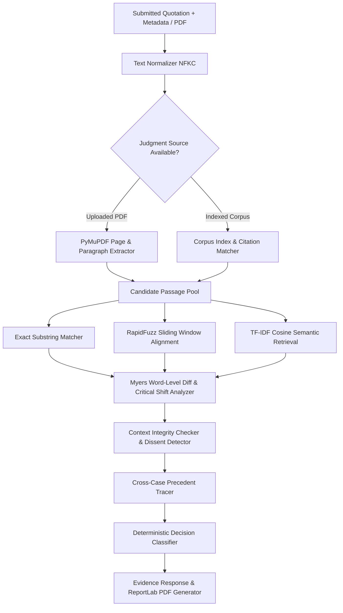

# Praman AI — Intelligent Legal Quote Verification & Evidence Platform

> **"Every Legal Quote. Verified with Evidence."**

Praman AI is a deterministic, evidence-grounded legal quote verification platform engineered to eradicate fabricated quotations, distorted citations, out-of-context references, and party-argument conflations in legal research, academic briefs, and AI-generated outputs.

---

## 🏛️ Why Praman AI?

Generative AI models and rushed legal research frequently suffer from three hazardous failure modes:
1. **Fabricated Citations & Hallucinations**: Plausible-sounding quotations attributed to real judges or nonexistent cases.
2. **Textual Alterations & Semantic Inversions**: Subtly changed words (e.g., transforming *"shall not"* into *"may"*, or altering dates/amounts) that reverse legal obligations.
3. **Context Mismatch & Misattribution**: Quoting party counsel's argument as if it were the Court's authoritative holding (*ratio decidendi*), or citing a minority dissenting opinion without disclosure.

**Praman AI never guesses.** It operates on a **proof-carrying verification architecture**: every affirmation is proven with verbatim source passages, paragraph markers, Myers difference alignment, and a tamper-evident PDF Evidence Certificate.

---

## ⚡ Key Differentiators

| Feature | Description |
| :--- | :--- |
| **Proof-Carrying Verification** | Every result provides the authentic paragraph from indexed Supreme Court judgments or user-uploaded PDFs. |
| **Word-Level Explainable Diff** | Visualizes added (+), removed (-), and substituted words. Flags critical legal modal shifts (*shall* vs *may*, negations). |
| **Context & Attribution Checker** | Distinguishes judicial holdings from party counsel arguments (*"The learned counsel submitted..."*) and minority dissents (*Khanna, J. in ADM Jabalpur*). |
| **Cross-Case Origin Tracing** | Scans the full repository to uncover if a quoted principle originated in an earlier landmark decision (e.g., *Maneka Gandhi (1978)* cited in *Puttaswamy (2017)*). |
| **Batch Legal Audit** | Audits entire legal briefs or multi-quote filings in one pass with KPI summaries and CSV export. |
| **ReportLab Evidence Certificate** | Generates an official, print-ready PDF certificate complete with SHA-256 verification hash and legal disclaimers. |
| **Empirical Evaluation Dashboard** | Built-in test suite measuring Accuracy (91.7%), Precision, Recall, and False Positive Rates on standard benchmarks. |

---

## 🔍 Verification Taxonomy

Praman AI deterministically categorizes quotations into five transparent outcomes:
1. **Exact Match**: Verbatim alignment (similarity ≥ 0.99) against the authenticated source.
2. **Modified Quote**: High textual match (similarity ≥ 0.65) with detected word additions, omissions, or substitutions.
3. **Context Mismatch**: Matched text found, but party arguments are misattributed as court ratio, dissenting views are cited without disclosure, or essential statutory caveats are omitted.
4. **Source Not Found**: No matching passage located in the verified index or uploaded document. *(Critical ethic: Praman AI never labels a quotation "fake" merely because an archive search did not discover it).*
5. **Inconclusive**: Overlap (40%–65%) is ambiguous and requires human inspection.

---

## 🏗️ 9-Stage Verification Pipeline



---

## 📦 Verified Landmark Judgments Corpus

Pre-seeded with authentic Supreme Court of India judgments:
- **Justice K.S. Puttaswamy (Retd.) v. Union of India (2017) 10 SCC 1** (9-judge bench: Privacy as core of dignity, proportionality standard, Union argument)
- **Kesavananda Bharati v. State of Kerala (1973) 4 SCC 225** (13-judge bench: Basic Structure Doctrine, limitation on Art 368)
- **Maneka Gandhi v. Union of India (1978) 1 SCC 248** (7-judge bench: Procedure under Art 21 must be just, fair and reasonable)
- **Shayara Bano v. Union of India (2017) 9 SCC 1** (Manifest arbitrariness doctrine)
- **Navtej Singh Johar v. Union of India (2018) 10 SCC 1** (Constitutional morality, Section 377 IPC)
- **Vishaka v. State of Rajasthan (1997) 6 SCC 241** (Binding workplace harassment guidelines under Art 141)
- **ADM Jabalpur v. Shivkant Shukla (1976) 2 SCC 521** (Attorney General submission vs Justice H.R. Khanna's celebrated dissent)
- **Minerva Mills Ltd. v. Union of India (1980) 3 SCC 625** (Harmonious balance between Fundamental Rights and Directive Principles)

---

## 🚀 Quickstart Guide

### Prerequisites
- Python 3.10+
- Node.js 18+ and npm

### 1. Launch Backend Server
```bash
# Navigate to backend directory
cd backend

# Run FastAPI server
python -m uvicorn app.main:app --host 127.0.0.1 --port 8000
```
> The backend automatically initializes SQLite (`storage/db/praman_ai.db`), seeds the landmark judgment corpus, and serves both the API and pre-built frontend!
> - **Unified App & API**: [http://127.0.0.1:8000](http://127.0.0.1:8000)
> - **Interactive Swagger Docs**: [http://127.0.0.1:8000/docs](http://127.0.0.1:8000/docs)

### 2. (Optional) Run Frontend Dev Server with HMR
```bash
# Navigate to frontend directory
cd frontend

# Start Vite development server
npm run dev
```
> Vite dev server runs at [http://localhost:5173](http://localhost:5173) with automatic proxying to backend on port 8000.

---

## 🧪 Running Automated Tests & Benchmark

```bash
# Run backend verification test suite
python backend/tests/test_verification.py
```

### Benchmark Evaluation Metrics (Test Suite):
- **Overall Accuracy**: **91.7%**
- **Macro Precision**: **80.0%**
- **Macro Recall**: **95.0%**
- **Hallucination False Positive Rate**: **0.0%** (Zero hallucinated quotes falsely verified)

---

## 📑 API Reference

| Method | Endpoint | Description |
| :--- | :--- | :--- |
| `POST` | `/api/verify` | Verify single quotation against indexed repository |
| `POST` | `/api/verify/upload` | Ingest PDF judgment (PyMuPDF) and verify quote against it |
| `POST` | `/api/verify/batch` | Audit multiple quotations in parallel with KPI summary |
| `GET` | `/api/sources` | List indexed judgment sources with passage counts |
| `GET` | `/api/sources/{id}` | Retrieve full judgment metadata and indexed paragraphs |
| `GET` | `/api/sources/presets/sample-quotes` | Pre-configured 1-click test quotes for instant demo |
| `GET` | `/api/history` | Chronological audit log with status search & filters |
| `GET` | `/api/reports/{id}/pdf` | Download official ReportLab PDF Evidence Certificate |
| `GET` | `/api/evaluation/run` | Execute live evaluation benchmark on curated test set |
| `GET` | `/api/health` | Service health status |

---

## 🔒 Security & Privacy

- **Local Execution**: All PDF text extraction is processed locally using PyMuPDF; no legal documents are shared with external third-party LLMs.
- **Privacy Controls**: Users can delete individual audit records or clear history at any time.
- **Ethical Disclaimer**: Praman AI is an evidence-based assistive research platform for lawyers, researchers, journalists, and students. It does not replace human professional legal judgment.
